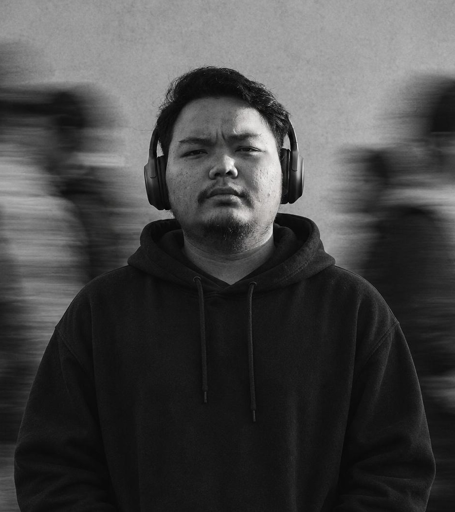

<div align="center">



# Hermawan — Digital Enthusiast

**Website portofolio pribadi: cepat, ringan, responsif, dan penuh detail kecil yang bikin betah.**

[](https://github.com/hirmiwin/portofolio)
[](https://github.com/hirmiwin/portofolio)
[](https://github.com/hirmiwin/portofolio/commits)
[](https://github.com/hirmiwin/portofolio)

[Demo Lokal](http://localhost/portofolio/) · [GitHub](https://github.com/hirmiwin) · [LinkedIn](https://www.linkedin.com/in/hermawan-hermawan-b03a8195/) · [Instagram](https://www.instagram.com/heywan_/) · [Email](mailto:hirmiwin@gmail.com)

</div>

---

## 👋 Tentang

Halo, aku **Hermawan** — digital enthusiast yang senang mengubah ide jadi pengalaman digital yang menyenangkan. Fokusku: website yang tidak hanya terlihat bagus, tapi juga **cepat, enak dipakai, dan ramah di semua perangkat**.

Sehari-hari aku ngulik HTML, CSS, JavaScript, dan sedikit CodeIgniter. Di luar coding, aku suka desain, fotografi, ngopi, dan belajar hal baru dari internet.

> “Website yang baik bukan cuma kelihatan bagus — tapi juga enak dipakai dan cepat.”

---

## ✨ Fitur

- **Responsif** — tampil rapi dari mobile sampai desktop.
- **Ringan** — HTML, CSS, dan JavaScript murni tanpa framework berat.
- **Animasi halus** — reveal on scroll, marquee, floating card, dan transisi interaktif.
- **Aksesibel** — navigasi keyboard, `aria-label`, dan dukungan `prefers-reduced-motion`.
- **Galeri foto** — lightbox dengan navigasi tombol dan keyboard, diisi dari `manifest.json`.
- **Form kontak** — membuka aplikasi email pengunjung dengan subjek dan isi pesan otomatis.
- **Halaman CV** — versi tampilan dan versi ATS-friendly.

---

## 🛠️ Teknologi

| Area | Teknologi |
| --- | --- |
| Markup | HTML5, Semantic HTML, SVG Sprite |
| Styling | CSS3, CSS Variables, Grid, Flexbox, Animasi |
| Interaktivitas | JavaScript (Vanilla), IntersectionObserver, Fetch API |
| Backend yang pernah dipakai | CodeIgniter, Laravel, MySQL |
| Desain | Figma |
| Tools | Git, GitHub, Laragon |

---

## 🚀 Proyek Pilihan

| Proyek | Deskripsi | Teknologi | Link |
| --- | --- | --- | --- |
| **Ananda Islamic School** | Website profil sekolah dengan frontend interaktif dan backend pengelola konten. | Laravel, HTML, CSS, JavaScript | [Kunjungi](https://anandaislamicschool.com/) |
| **Pendaftaran Siswa Baru** | Aplikasi pendaftaran siswa baru online. | CodeIgniter | [Buka aplikasi](http://103.14.111.110/pendaftaran/) |
| **Aplikasi Rapor Sekolah** | Portal rapor digital untuk mengakses hasil belajar siswa. | Rapor Digital, Sekolah | [Login](http://103.14.111.110/rapor/) |
| **Portofolio 1.0** | Website portofolio pertama: responsif, ringan, penuh eksperimen animasi CSS. | HTML, CSS, JavaScript | Dalam repo ini |

---

## 🧭 Pengalaman Singkat

- **Freelance Web Developer** — Remote, Indonesia _(2020 — sekarang)_
  Membangun landing page, company profile, dan website portofolio untuk UMKM serta kreator.
- **Co-Founder** — RHT Official _(2020 — 2023)_
- **Head IT Department** — Ananda Islamic School, Jakarta _(2016 — sekarang)_
  Mengelola infrastruktur TI, sistem sekolah, basis data, keamanan, dan transformasi digital.
- **S1 Sistem Informasi** — Universitas Bina Nusantara _(2012 — 2015)_

Lihat detail lengkap di [CV.pdf](assets/CV.pdf) atau [cv-ats.html](cv-ats.html).

---

## 📁 Struktur Repo

```text
portofolio/
├── assets/
│   ├── CV.pdf
│   └── img/
│       ├── avatar.svg
│       ├── hermawan.jpg
│       ├── hermawann.jpg
│       └── photos/            # galeri opsional + manifest.json
├── css/
│   └── style.css              # tokens, layout, animasi, responsive
├── js/
│   └── main.js                # navbar, reveal, form, gallery lightbox
├── cv.html                    # tampilan CV
├── cv-ats.html                # CV versi ATS
├── index.html                 # halaman utama
└── README.md
```

---

## 💻 Menjalankan Secara Lokal

### Opsi 1 — Laragon

1. Pastikan folder repo berada di `C:\laragon\www\portofolio`.
2. Jalankan Laragon, lalu buka:

```text
http://localhost/portofolio/
```

### Opsi 2 — PHP Built-in Server

```bash
cd portofolio
php -S localhost:8000
```

Lalu buka `http://localhost:8000/`.

### Opsi 3 — VS Code Live Server

Klik kanan `index.html` → **Open with Live Server**.

---

## ⚙️ Kustomisasi

- **CV**: ganti `assets/CV.pdf` dengan file terbaru (nama file tetap sama).
- **Foto profil**: ganti `assets/img/hermawan.jpg` dan `assets/img/hermawann.jpg`.
- **Galeri foto**: taruh gambar di `assets/img/photos/`, lalu daftarkan di `assets/img/photos/manifest.json`:

```json
[
  { "src": "foto-1.jpg", "title": "Senja di Jalanan", "alt": "Foto senja di jalanan" },
  "foto-2.jpg"
]
```

- **Email kontak**: ubah alamat di `index.html` dan variabel `EMAIL` di `js/main.js`.

---

## 📬 Kontak

Punya proyek, pertanyaan, atau sekadar mau kenalan? Aku biasanya balas dalam 1–2 hari.

- 📧 **Email:** [hirmiwin@gmail.com](mailto:hirmiwin@gmail.com)
- 🐙 **GitHub:** [@hirmiwin](https://github.com/hirmiwin)
- 💼 **LinkedIn:** [Hermawan](https://www.linkedin.com/in/hermawan-hermawan-b03a8195/)
- 📸 **Instagram:** [@heywan_](https://www.instagram.com/heywan_/)

---

<div align="center">

© 2026 Hermawan. Dibuat dengan banyak minum kopi ☕

[⬆ Kembali ke atas](#hermawan--digital-enthusiast)

</div>
